# SupportDesk — Blazor UI and AI Agent API

SupportDesk is a full-stack .NET 10 demonstration project for building a customer-support assistant with Blazor and an ASP.NET Core API. The API uses Microsoft Agent Framework with Azure AI Foundry, persistent EF Core sessions, SQL Server data, and customer-scoped tools for order and shipment information.

This repository is created as a YouTube video series. The numbered `SessionN` branches correspond to individual Agent sessions/episodes. Code is merged from a published session branch into `master` after the video is published. To follow the latest implementation, start with the branch that has the highest numeric `SessionN` suffix.

> [!IMPORTANT]
> The repository currently contains development credentials and endpoints for demonstration purposes. Replace them with environment variables or a secret manager before using the project outside a local learning environment.

## Repository structure

| Project | Type | Responsibility |
|---|---|---|
| `SupportDesk` | ASP.NET Core Minimal API / .NET 10 | AI agents, Foundry integration, EF Core, SQL Server, customer context, chat endpoints, tools |
| `SupportDesk.Playground` | Blazor Server interactive UI / .NET 10 | Chat playground and demonstration pages |
| `SupportDesk.slnx` | Visual Studio solution | Opens both projects together |

```text
SupportDesk/
├── SupportDesk/                  # API project
│   ├── Agents/                   # Agent definitions and registry
│   ├── Configuration/            # Azure Foundry options
│   ├── Data/                     # DbContext, entities, and EF configurations
│   ├── Endpoints/                # Minimal API chat endpoints
│   ├── Http/                     # x-customer-id middleware
│   ├── Migrations/               # EF Core migrations
│   ├── Models/                   # API response models
│   ├── Scripts/                  # SQL Server seed script
│   ├── Services/                 # Agent chat orchestration
│   ├── Sessions/                 # SQL-backed conversation sessions
│   └── Tools/                    # Order, shipment, and refund tools
└── SupportDesk.Playground/       # Blazor UI project
	├── Components/Pages/         # Chatbot and dashboard pages
	├── Services/                 # API client and UI session state
	└── wwwroot/                  # Static assets
```

## Technology overview

- .NET 10
- ASP.NET Core Minimal APIs
- Blazor Server with interactive server components
- Entity Framework Core 10
- SQL Server
- Azure AI Foundry / Azure AI Projects
- Azure CLI credential authentication
- Microsoft Agent Framework
- OpenAPI and Scalar API documentation
- Bootstrap for Blazor styling

## Features

- A support agent named `support`.
- Agent instructions that restrict answers to the signed-in customer's data.
- Order tools for recent orders and order details.
- Shipment tools for shipment status and tracking information.
- Tool-backed answers instead of guessed order details.
- SQL-backed agent session state for continuing a conversation.
- Customer isolation using the `x-customer-id` request header.
- Seed data for customers, addresses, products, orders, shipments, and shipment events.
- Interactive Blazor chat playground.
- OpenAPI and Scalar documentation in the Development environment.

## Current implementation flow

```mermaid
flowchart LR
	U[User in Blazor Chatbot] -->|Prompt + Customer ID| C[ApiClient]
	C -->|POST /api/agents/support/chat| M[x-customer-id Middleware]
	M -->|Validate customer header| E[Chat Endpoint]
	E -->|Agent name and message| S[AgentChatService]
	S -->|Load state| DB[(SQL Server)]
	S -->|Build or reuse agent| F[Azure AI Foundry]
	F -->|Function-call decision| T[Order / Shipment Tools]
	T -->|Customer-scoped EF Core query| DB
	F -->|Final response| S
	S -->|Save serialized session| DB
	S -->|ChatResult with conversationId| E
	E -->|JSON response| C
	C -->|Render response| U
```



### Conversation lifecycle

1. The Blazor user enters a customer ID and prompt.
2. The UI sends `x-customer-id` and creates a POST request to `/api/agents/support/chat`.
3. API middleware requires the customer header for every `/api` request.
4. The first request creates a conversation ID. Subsequent requests reuse it so session state can continue.
5. `AgentChatService` loads the serialized session from `AgentSessions` using both customer ID and conversation ID.
6. The agent calls tools when the prompt requires order or shipment data.
7. Tools query SQL Server and return data only for the current customer context.
8. The API returns the assistant reply and conversation ID.
9. The Blazor page renders the reply and keeps the conversation ID until the page is cleared.

## Prerequisites

### Required

- Windows 10/11 or another supported development OS
- Visual Studio 2026 or Visual Studio Code
- .NET 10 SDK
- SQL Server 2022 or a compatible SQL Server instance
- Azure AI Foundry access
- Azure CLI

Verify the SDK and Azure CLI:

```powershell
dotnet --version
az --version
```

### SQL Server options

You can use a local SQL Server instance or run SQL Server in Docker.

Example SQL Server container:

```powershell
docker run --name supportdesk-sql `
  -e "ACCEPT_EULA=Y" `
  -e "MSSQL_SA_PASSWORD=Rahul@123456789" `
  -p 1433:1433 `
  -d mcr.microsoft.com/mssql/server:2022-latest
```

The default password in `appsettings.json` is for local demonstration only. If you change the password, update the API connection string as shown below.

## Configuration

### 1. SQL Server connection string

The API reads `ConnectionStrings:DefaultConnection` from `SupportDesk/appsettings.json` or `SupportDesk/appsettings.Development.json`.

For local development, configure a user secret instead of committing credentials:

```powershell
cd SupportDesk
dotnet user-secrets init
dotnet user-secrets set "ConnectionStrings:DefaultConnection" "Server=127.0.0.1,1433;Database=SupportDesk;User Id=sa;Password=YOUR_PASSWORD;TrustServerCertificate=True;"
```

You can also use an environment variable:

```powershell
$env:ConnectionStrings__DefaultConnection = "Server=127.0.0.1,1433;Database=SupportDesk;User Id=sa;Password=YOUR_PASSWORD;TrustServerCertificate=True;"
```

### 2. Azure AI Foundry configuration

The API reads `Foundry:ProjectEndpoint` and `Foundry:ModelDeployment` from configuration.

Set them as development secrets:

```powershell
cd SupportDesk
dotnet user-secrets set "Foundry:ProjectEndpoint" "https://YOUR-FOUNDRY-RESOURCE.services.ai.azure.com/api/projects/YOUR-PROJECT"
dotnet user-secrets set "Foundry:ModelDeployment" "YOUR-MODEL-DEPLOYMENT-NAME"
```

Or use environment variables:

```powershell
$env:Foundry__ProjectEndpoint = "https://YOUR-FOUNDRY-RESOURCE.services.ai.azure.com/api/projects/YOUR-PROJECT"
$env:Foundry__ModelDeployment = "YOUR-MODEL-DEPLOYMENT-NAME"
```

The Foundry client uses `AzureCliCredential`, so authenticate your Azure CLI before running the API:

```powershell
az login
az account set --subscription "YOUR-SUBSCRIPTION-ID"
```

The signed-in account must have access to the Azure AI Foundry project and model deployment.

### 3. Blazor API base URL

`SupportDesk.Playground/appsettings.json` contains:

```json
{
  "Api": {
	"BaseUrl": "https://localhost:7062"
  }
}
```

Keep this value aligned with the API HTTPS launch profile. It can be overridden with:

```powershell
$env:Api__BaseUrl = "https://localhost:7062"
```

## Database setup

EF Core migrations create the SQL Server schema. The migrations in this repository are:

- `20261101100847_IntialTableCreation`
- `20261112110815_AddAgentSessionTable`

### Option A: Visual Studio Package Manager Console

Open **Tools > NuGet Package Manager > Package Manager Console**, select `SupportDesk` as the default project, and run:

```powershell
Update-Database
```

### Option B: .NET CLI

Install the EF Core CLI tool if it is not already available:

```powershell
dotnet tool install --global dotnet-ef
```

Restore and create/update the database:

```powershell
dotnet restore
cd SupportDesk
dotnet ef database update
```

### Verify migrations

List the migrations known to the project:

```powershell
dotnet ef migrations list
```

Inspect migration SQL without changing the database:

```powershell
dotnet ef migrations script
```

To remove the latest migration before it has been applied:

```powershell
dotnet ef migrations remove
```

To add a future migration:

```powershell
dotnet ef migrations add YourMigrationName
```

## Seed the database

After `Update-Database` or `dotnet ef database update`, run the seed script:

```powershell
sqlcmd `
  -S 127.0.0.1,1433 `
  -d SupportDesk `
  -U sa `
  -P "Rahul@123456789" `
  -C `
  -i .\SupportDesk\Scripts\seed.sqlserver.sql
```

The script inserts six demonstration customers and related orders, products, shipments, shipment events, and addresses. Customer IDs currently range from `1` to `6`.

A particularly useful customer for the chatbot is customer `1`:

- Recent orders: `1031`, `1038`, `1042`
- Example prompt: `What were my most recent orders?`
- Example shipment prompt: `Where is order 1042?`

## Running the solution

### Visual Studio

1. Open `SupportDesk.slnx`.
2. Set both `SupportDesk` and `SupportDesk.Playground` as startup projects:
   - Right-click the solution.
   - Select **Configure Startup Projects**.
   - Choose **Multiple startup projects**.
   - Set both projects to **Start**.
3. Start without debugging or press `F5`.
4. Open the Blazor URL from the `https` launch profile, normally `https://localhost:7010`.

### .NET CLI

Open two terminals.

API:

```powershell
cd SupportDesk
dotnet run --launch-profile https
```

Blazor UI:

```powershell
cd SupportDesk.Playground
dotnet run --launch-profile https
```

Default local URLs:

| Application | HTTPS URL | HTTP URL |
|---|---|---|
| API | `https://localhost:7062` | `http://localhost:5066` |
| Blazor UI | `https://localhost:7010` | `http://localhost:5152` |

In Development mode:

- OpenAPI: `https://localhost:7062/openapi/v1.json`
- Scalar: `https://localhost:7062/scalar/v1`

## Using the Blazor chatbot

1. Open the Blazor playground.
2. Enter a customer ID such as `1`.
3. Enter a prompt.
4. Submit the prompt.
5. Continue using the same conversation to test session memory.
6. Use **Clear** to start a new conversation ID.

Try prompts such as:

- `What did I order recently?`
- `Show me the details for order 1042.`
- `What is the shipment status for order 1042?`
- `Where is the package for order 1042?`
- `Please refund order 1042.`

The support agent is intentionally not authorized to process refunds. The current agent instruction requires it to decline refund requests.

## API reference

### List agents

```http
GET /api/agents
```

Example:

```powershell
Invoke-RestMethod -Uri "https://localhost:7062/api/agents" -SkipCertificateCheck
```

### Chat with support agent

```http
POST /api/agents/support/chat
x-customer-id: 1
Content-Type: application/json

{
  "message": "What is the status of order 1042?",
  "conversationId": null
}
```

PowerShell example:

```powershell
$body = @{ message = "What is the status of order 1042?" } | ConvertTo-Json

Invoke-RestMethod `
  -Uri "https://localhost:7062/api/agents/support/chat" `
  -Method Post `
  -Headers @{ "x-customer-id" = "1" } `
  -ContentType "application/json" `
  -Body $body `
  -SkipCertificateCheck
```

Response shape:

```json
{
  "data": "Agent reply text",
  "conversationId": "generated-or-reused-conversation-id"
}
```

Reuse `conversationId` in later requests to preserve the session:

```json
{
  "message": "What was the tracking number?",
  "conversationId": "your-returned-conversation-id"
}
```

### API error responses

| Status | Cause |
|---|---|
| `400 Bad Request` | The message is missing or blank. |
| `401 Unauthorized` | The `x-customer-id` header is missing for an `/api` request. |
| `404 Not Found` | The requested agent name is unknown. |

The API validates the message and customer context before invoking the agent.

## Database model summary

The main EF Core entities are:

| Entity | Purpose |
|---|---|
| `Customer` | Customer identity, tier, and contact information |
| `Address` | Customer shipping and billing-style addresses |
| `Product` | Product catalog, price, stock, and return policy |
| `Order` | Customer order header and status |
| `OrderItem` | Individual product lines inside an order |
| `Payment` | Payment records associated with an order |
| `Shipment` | Carrier and delivery information |
| `ShipmentEvent` | Tracking events for a shipment |
| `Refund` / `RefundApproval` | Refund workflow entities |
| `AgentSession` | Serialized conversation state, keyed by customer and conversation |
| `WorkflowInstance` | Agent/workflow state support |

EF Core conventions in `SupportDeskDbContext` apply two decimal precision and UTC conversion conventions to `DateTime` properties.

## Agent architecture

- `IAgentDefinition` defines an agent name, description, instructions, and tools.
- `SupportAgentDefinition` implements the support agent.
- `FoundryAgentBuilder` creates the Azure AI agent with model, instructions, name, and tools.
- `AgentRegistry` discovers and builds agent definitions.
- `AgentChatService` creates or restores sessions and executes agent turns.
- `SqlSessionStore` persists serialized session JSON in SQL Server.
- `CustomerContextMiddleware` reads `x-customer-id` and makes the customer context available to tools.

Add another agent by implementing `IAgentDefinition` and registering it through the assembly discovery extension; no additional registry class registration is normally required.

## YouTube session and branch guide

Each branch represents a step in the YouTube series. `master` is the published baseline/merge branch, and session branches represent episodes that are merged only after publication.

| Branch | Series stage | Video Title | YouTube video |
|---|---|---:|---|
| `master` | Session 1 / baseline | Microsoft Agent Framework in C#: AI Agents Without Python | https://youtu.be/XiBFsnrX_AU |
| `Session2` | Agent Session 2 | Build Your First AI Agent in C# with Microsoft Agent Framework (.NET 10)h | https://youtu.be/wc05lFtshhc |
| `Session3` | Agent Session 3 | AI Agent Tools in C#: Function Calling with Microsoft Agent Framework (.NET 10) | https://youtu.be/eDYZTiTiaBw |
| `Session4` | Agent Session 4 | Build a C# AI Agent That Actually Remembers the Conversation | https://youtu.be/CoRMOos1bpg |
| `Session5` | Agent Session 5 | Blazor Integration | In Progress |

Because `Session5` is the branch with the highest numeric suffix currently available, it contains the newest session content. Remote branches may include newer sessions later.

### Find the latest session branch

From PowerShell:

```powershell
git fetch --all --prune
git branch -a
```

Local branches can also be sorted numerically:

```powershell
git for-each-ref --sort=refname --format="%(refname:short)" refs/heads | Where-Object { $_ -match '^Session\d+$' }
```

To switch to a session:

```powershell
git switch Session4
```

To return to published code:

```powershell
git switch master
git pull origin master
```

### Branch publishing workflow

```powershell
# Work in a session branch
git switch SessionN

# Create and commit the episode implementation
git add .
git commit -m "Implement Agent Session N"

# Push the episode branch
git push origin SessionN

# After the YouTube video is published, merge into master
git switch master
git merge SessionN
git push origin master
```

Create the next session branch from the latest published code:

```powershell
git switch master
git pull origin master
git switch -c SessionN
```

Replace `SessionN` with the actual next suffix, for example `Session6`.

## Creating a new EF migration

1. Modify an entity or EF Core configuration.
2. Run the migration command from the repository root:

```powershell
cd SupportDesk
dotnet ef migrations add DescriptiveMigrationName
```

3. Review the generated migration and snapshot changes.
4. Apply the migration:

```powershell
dotnet ef database update
```

5. Add or update seed data if the migration requires initial data.

## Troubleshooting

### SQL Server cannot be reached

- Confirm Docker SQL Server is running: `docker ps`
- Confirm port `1433` is exposed.
- Confirm the database server and credentials in `ConnectionStrings:DefaultConnection`.
- Add `TrustServerCertificate=True` for local development.

### EF migration error: tools or startup fail

Install or update the EF CLI tool:

```powershell
dotnet tool install --global dotnet-ef --force
```

Then confirm that the API project can start and has valid configuration:

```powershell
cd SupportDesk
dotnet ef migrations list
```

### Foundry authentication fails

- Run `az login` and confirm the correct subscription.
- Confirm the account has access to the Foundry project.
- Confirm `Foundry:ProjectEndpoint` and `Foundry:ModelDeployment` are set.
- Do not set `FOUNDRY_ENDPOINT` unless the application configuration also consumes it; the current code reads `Foundry:ProjectEndpoint`.

### The API returns `401 Unauthorized`

Every `/api` request requires:

```http
x-customer-id: 1
```

The Blazor API client automatically sends this header, but direct HTTP clients must add it manually.

### The API returns `404 Not Found`

The current registered agent name is `support`. Use:

```text
/api/agents/support/chat
```

### The Blazor UI cannot connect to the API

- Verify the API is running on the configured HTTPS URL.
- Confirm `Api:BaseUrl` matches the API launch profile.
- Trust or bypass the local development certificate if needed.
- Allow both applications to run simultaneously in Visual Studio or two terminals.

### Local HTTPS certificate problems

```powershell
dotnet dev-certs https --trust
```

## Build and validation

Restore and build the solution:

```powershell
dotnet restore
dotnet build
```

Run both projects and test the API through Scalar or the chatbot UI.


## Reach out to me via any of the following channels
1. Discord : [DevBeyondCode](https://discord.com/invite/Szs9ypCdRj)
2. Contact Me : [www.devbeyondcode.com/](https://www.devbeyondcode.com/contact/)
3. LinkedIn : [www.linkedin.com/](https://www.linkedin.com/in/rahulpandey15/)

